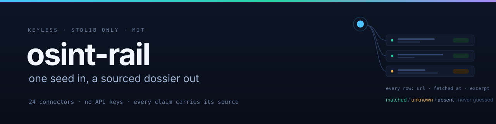

# osint-rail

**Keyless OSINT for people who have to show their work.** It replaces paid people-search
APIs and one-off scrapers: one seed in, a sourced dossier out, and every line carries the
URL it came from, the time it was fetched and the excerpt it was read from.

[Quick start](#quick-start) · [Commands](#commands) · [MCP](#mcp) · [How it works](#how-it-works) · [Limits](#limits) · [Changelog](CHANGELOG.md)

<sub>Part of the keyless stack — public data for agents, with receipts. No API key anywhere.</sub>

[](https://github.com/shattradingle/osint-rail/actions/workflows/ci.yml)
[](https://github.com/shattradingle/osint-rail/releases)
[](LICENSE)
[](pyproject.toml)

24 connectors cover usernames, emails, domains, IPs, names and URLs, pivoting breadth-first
from every hit and storing the evidence in a local SQLite ledger. Stdlib only, Python 3.10+,
no account and nothing to configure. When a source blocks the request it is recorded as
UNKNOWN with the reason, never quietly turned into "not found".

## Quick start

```console
$ uvx --from git+https://github.com/shattradingle/osint-rail osint-rail case example.com --depth 0
…
*Generated 2026-11-21T15:10:32Z | 10 requests | 25 sourced claims | 26 rows | 4.1s | stop: complete*

## Coverage

`matched 3 / weak 0 / absent 1 / unknown 1 of 5 checks | 10 requests | 4.1s | 25 claims`

| connector | seed | outcome | reason |
|---|---|---|---|
| otx | domain:example.com | unknown | otx rate-limited (429) |
| hackertarget | domain:example.com | matched |  |
| websearch | domain:example.com | matched |  |
| urlscan | domain:example.com | absent | 0 results |
| domain | domain:example.com | matched |  |
…
```

Measured 2026-11-21 on a home connection. Your numbers will differ: OTX was
rate-limited on this run, and that row is the point.

| You have | Start at |
|---|---|
| an agent that should do the looking | [MCP](#mcp), two tools and no config |
| a terminal | [Install](#install), then [Commands](#commands) |
| doubts | [How it works](#how-it-works) and [Limits](#limits), both short |

## What a run actually gives you

Every row in the ledger is one JSON object. This is a real row from an `example.com` run:

```json
{
  "kind": "domain",
  "predicate": "rdap_registration",
  "value": "1995-08-14T04:00:00Z",
  "source": "rdap",
  "url": "https://rdap.org/domain/example.com",
  "excerpt": "{\"eventAction\": \"registration\", \"eventDate\": \"1995-08-14T04:00:00Z\"}",
  "confidence": 0.85,
  "fetched_at": "2026-11-21T15:07:22Z",
  "sensitivity": "public",
  "extra": {}
}
```

`kind`, `predicate` and `value` are the claim. `url`, `excerpt` and `fetched_at` are why you
are allowed to repeat it. Claims are single-sourced unless two rows agree on the same value;
the dossier says so in its own run notes rather than implying consensus.

## Comparison

| feature | this | the alternative people use | why it matters |
|---|---|---|---|
| setup | `uvx`, no key, no account | paid people-search API: contract, key, per-lookup billing | a dossier costs time, not money or a ToS negotiation |
| evidence | URL + fetch time + excerpt on every row | API records with no source, scrapers returning dicts | you can defend a line in a report or an email |
| blocked source | `unknown` plus the reason | usually an empty list, indistinguishable from "no account" | silence is not evidence |
| username coverage | a capped, audited sample of merged WhatsMyName + Maigret | Maigret and Sherlock ship the full, maintained site lists | **they are better at breadth**; run them when you want every site, run this when you want a ledger |
| identity | deterministic merges, scored candidates with reasons | opaque confidence scores, or none at all | "same handle" stops being a conclusion |
| agent use | CLI and MCP with one JSON object per run | REST API you have to wrap | the agent gets the evidence, not a summary of it |

## The rules the code enforces

1. **Evidence or nothing.** Every claim is built by one helper that requires a source URL,
   a fetch time and a non-empty excerpt ([connectors.py](src/osint_rail/connectors.py)), and
   the `claims` table has all three as `NOT NULL` ([model.py](src/osint_rail/model.py)).
2. **Tri-state, not boolean.** Every connector run stores one check: `matched`, `weak`,
   `absent` or `unknown` ([engine.py](src/osint_rail/engine.py)). A 403, 429, bot challenge,
   timeout or spent budget is `unknown` with the reason attached.
3. **Same handle is not the same person.** A merge needs a deterministic key: same account,
   same profile URL, same email, same IP. Name and bio similarity only produces a scored
   candidate link, with its reasons printed ([resolve.py](src/osint_rail/resolve.py)).
4. **Budgeted, polite, audited.** One HTTP client per case, capped by requests and wall
   clock, one request per second per host, and every request written to `requests` with its
   status and elapsed time ([net.py](src/osint_rail/net.py)).
5. **Public only.** No login, no CAPTCHA solving, no proxy rotation, no breach data, no fake
   accounts. A block is a stop; retrying 429s is how a research tool becomes a nuisance.
6. **No model memory.** The optional AI layer is off by default, sees only the claims this
   run fetched, and may only echo values that exist in them ([ai.py](src/osint_rail/ai.py)).

## How it works

```
seed (username | email | domain | ip | name | url)
  │
  ├─ planners pick the connectors registered for that seed kind
  │    and drop anything above the allowed sensitivity
  │
  ├─ fan-out, concurrent, 1 request/s/host, one shared budget
  │    ├─ github ───── profile, commit emails ─────────┐
  │    ├─ gravatar ─── verified accounts ──────────────┤ new seeds, depth + 1
  │    ├─ domain ───── A, MX, NS, TXT, SPF, DMARC, RDAP ┤ (each is deduped, so a
  │    ├─ websearch ── top 10 mentions ────────────────┘  cycle cannot form)
  │    └─ whatsmyname ─ sampled registration probe
  │
  ├─ one check row per connector run: matched | weak | absent | unknown
  ├─ one claim row per finding: url · fetched_at · excerpt · confidence
  │
  ├─ SQLite (cases, claims, checks, requests, seeds)
  └─ markdown dossier + graph JSON + MCP response
```

[docs/architecture.md](docs/architecture.md) traces the flow through the files, with the
line where each rule is enforced.

## Install

Python 3.10 or newer. Nothing else. `uvx` and `pipx` routes do not need a checkout:

```console
# 1. run it once, no install
uvx --from git+https://github.com/shattradingle/osint-rail osint-rail case torvalds --depth 1

# 2. install the command
pipx install git+https://github.com/shattradingle/osint-rail
osint-rail case torvalds --depth 1

# 3. install into the current environment
pip install git+https://github.com/shattradingle/osint-rail
osint-rail case torvalds --depth 1
```

State lives in `$XDG_STATE_HOME/osint-rail` (usually `~/.local/state/osint-rail`), overridable
with `OSINT_RAIL_HOME`. That directory holds `cases.db` and one `.md`, `.graph.json` and
`.json` per case.

## Commands

| command | what it does |
|---|---|
| `osint-rail case <seed>` | run a case; `--depth`, `--max-requests`, `--max-seconds`, `--max` |
| `osint-rail probe <connector> <seed>` | run one connector and print its check, for testing |
| `osint-rail show <case_id>` | re-render a stored case without touching the network |
| `osint-rail list` | recent cases; `--limit` |
| `osint-rail delete <case_id>` | remove the case and its claims, checks and requests |
| `osint-rail connectors` | every connector, the seeds it accepts, its state |
| `osint-rail mcp` | serve MCP over stdio |

`--json` on `case`, `show`, `list`, `connectors` and `probe` prints exactly one object.
`--quiet` prints nothing on success. `--no-color` disables ANSI colour (also honours `NO_COLOR`).

Exit codes: `0` ok · `1` nothing found or the run could not complete · `2` every check was
blocked · `64` usage error.

## MCP

The server speaks line-delimited JSON-RPC 2.0 on stdin/stdout, so it drops into Claude Desktop,
Cursor, DSH or any other stdio MCP client. It exposes three tools:
`osint_case` (run and return the dossier), `osint_show` (re-render a stored case) and
`osint_connectors` (what this install can ask). `osint_case` returns the markdown dossier
plus `structuredContent` with the coverage counts.

```json
{
  "mcpServers": {
    "osint-rail": {
      "command": "uvx",
      "args": ["--from", "git+https://github.com/shattradingle/osint-rail", "osint-rail", "mcp"]
    }
  }
}
```

## Connectors

Generated from `osint-rail connectors --json`; the list is the registry, not a copy.

| connector | seeds | pulls |
|---|---|---|
| `github_commits` | email | GitHub commit search by author email (public commits) |
| `gravatar` | email | Gravatar public profile by email hash |
| `openpgp` | email | keys.openpgp.org key presence by email |
| `chesscom` | username | Chess.com public player profile |
| `codeberg` | username | Codeberg (Gitea) public user profile |
| `github` | username | GitHub public profile + commit author emails |
| `gitlab` | username | GitLab public user profile |
| `hackernews` | username | Hacker News profile (about text, karma, creation date) |
| `mastodon` | username | Mastodon.social account lookup (local instance only) |
| `mojang` | username | Minecraft account UUID (Mojang API) |
| `npm` | username | npm packages maintained by a username |
| `pypi` | username | PyPI user page (published projects) |
| `telegram` | username | Telegram public preview page (t.me) |
| `whatsmyname` | username | Username registration probe over merged WhatsMyName + Maigret lists |
| `bluesky` | handle | Bluesky public profile by handle |
| `companieshouse` | name | UK Companies House officer search (public register) |
| `orcid` | name | ORCID researcher search by name |
| `domain` | domain | DNS records (A/MX/NS/TXT) + RDAP registration |
| `hackertarget` | domain | hackertarget hostsearch: subdomains + IPs |
| `otx` | domain | AlienVault OTX passive DNS (subdomains + IPs) |
| `urlscan` | domain | urlscan.io public search for pages on a domain |
| `websearch` | domain, email, handle, name, username | DuckDuckGo Lite web mentions (top 10, one query) |
| `ip` | ip | ip-api geo/ASN + Shodan InternetDB ports/hostnames |
| `page` | url | Public page extraction (title, description, mailto, tel, social links) |

## Limits

Measured on 2026-11-21, on the same connection as the demo, and written down because the
next person will hit them too.

- **A quarter of the username sites do not answer.** A 270-site sweep (150 strong + 120 weak,
  the `--max` preset) returned `14 matched / 25 weak / 169 no / 62 blocked` for `torvalds`.
  62 blocked is 23%. Blocked sites are `unknown`, so the run never claims they are empty.
- **A "strong" username match is still a lead.** The same 14 sites reported a strong hit for
  `TorvaldsDB`, a different handle found through a pivot, and 2 of 35 sites did the same for a
  random 15-character string. Some sites return their profile markup for any string. That is
  why nothing is merged on a handle alone.
- **GitHub's API refuses unauthenticated traffic from this network.** `github` and
  `github_commits` returned `HTTP 403` here. Unauthenticated REST is [60 requests an hour per
  IP](https://docs.github.com/en/rest/using-the-rest-api/rate-limits-for-the-rest-api);
  setting `GITHUB_TOKEN` raises the ceiling. Nothing in this tool requires a token.
- **PyPI serves a bot challenge** to the user page, recorded as `unknown`. The `pypi`
  connector will tell you it could not check, which is the intended behaviour.
- **OTX rate-limits quietly.** One run in two returned `429`; `urlscan` returned zero pages
  for `example.com`. Both are recorded, neither is retried.
- **Web search is one query.** DuckDuckGo Lite, top 10, no pagination, no link following.
  Treat mention rows as pointers to open by hand.
- **No phone and no image connector.** There is no lawful keyless path for either that this
  repo is willing to ship. They are a documented gap, not a roadmap item.
- **The username sweep downloads two community datasets on first use** (WhatsMyName, Maigret)
  and caches them in memory for the process. Offline, it reports `unknown`, not absence.
- **`--max` spends the whole budget.** Depth 3, 480 requests, 150 strong + 120 weak site
  checks. Measured on `torvalds`: 28 checks, 480 requests, 21.2 s, 105 sourced claims,
  `12 matched / 0 weak / 11 absent / 5 unknown`. Extra checks buy more unknowns and more
  leads, not more certainty.
- **The defaults are deliberately small**: depth 2, 120 requests, 180 seconds, 40 strong +
  20 weak site checks. Start there, read the coverage line, then raise it.
- **CI covers Python 3.10 to 3.13 on Linux and 3.12 on macOS and Windows.** The suite opens
  no sockets, so it runs the same everywhere.

## Ethics and scope

Public data only. No login walls, no CAPTCHA solving, no proxy rotation to get around a
block, no breach or stealer data, no fake accounts. A block is recorded as a stop, not
worked around. What this produces is registrations and records with their sources, not a
verdict about a person; deciding who is who is your job, and the dossier shows its working
so someone else can check it.

## Tests

98 tests, offline, one seam (a fake transport) for all HTTP:

```console
$ pytest -q
98 passed in 3.20s
```

## Part of the keyless stack

Public data for agents, with receipts. No API key anywhere:

- **[reddit-rail](https://github.com/shattradingle/reddit-rail)** — Reddit research for your agent: search threads and read whole comment trees.
- **[osint-rail](https://github.com/shattradingle/osint-rail)** — one seed in, a sourced dossier out, every claim with its URL.
- **[receipts](https://github.com/shattradingle/receipts)** — a research desk that only quotes what it fetched.

## Licence

MIT. See [LICENSE](LICENSE). The username sweep reads community data sets that keep their
own licences; check the [WhatsMyName](https://github.com/WebBreacher/WhatsMyName) and
[Maigret](https://github.com/soxoj/maigret) repos before redistributing either.
